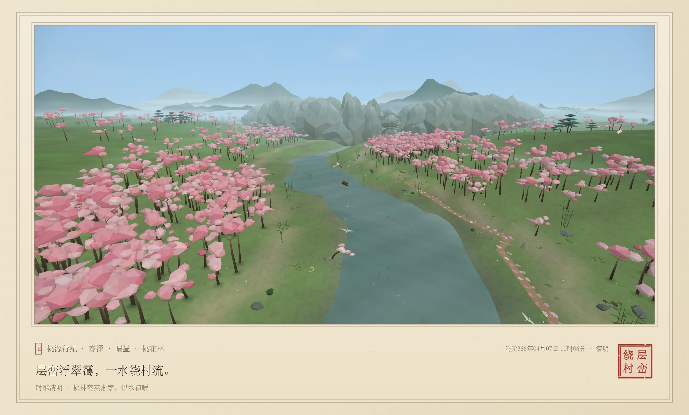
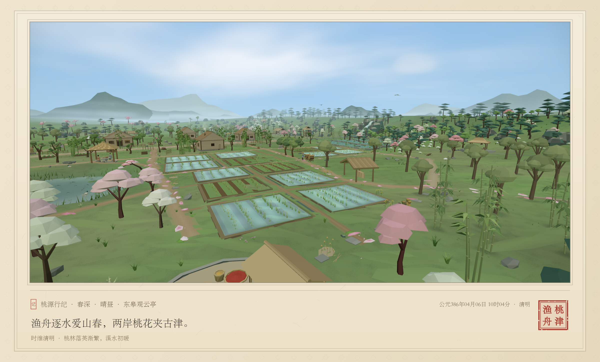
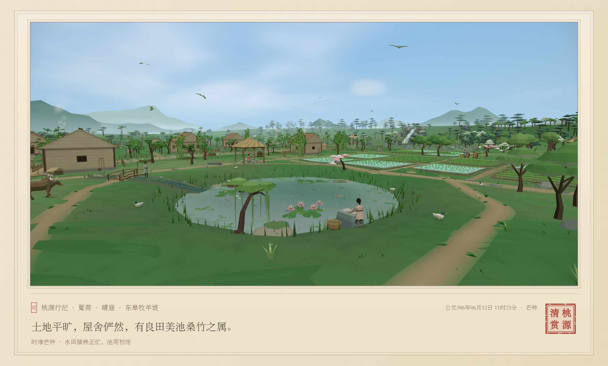
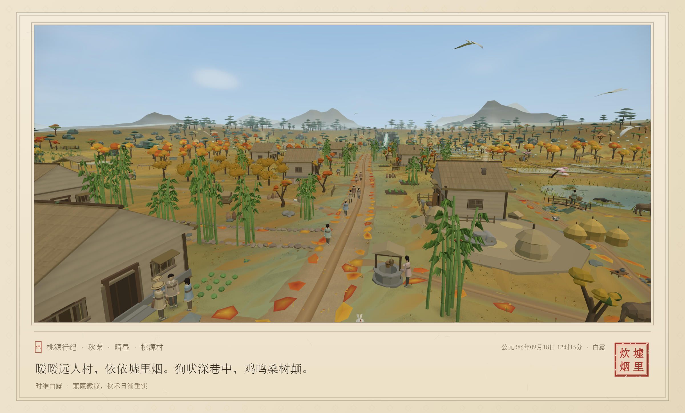
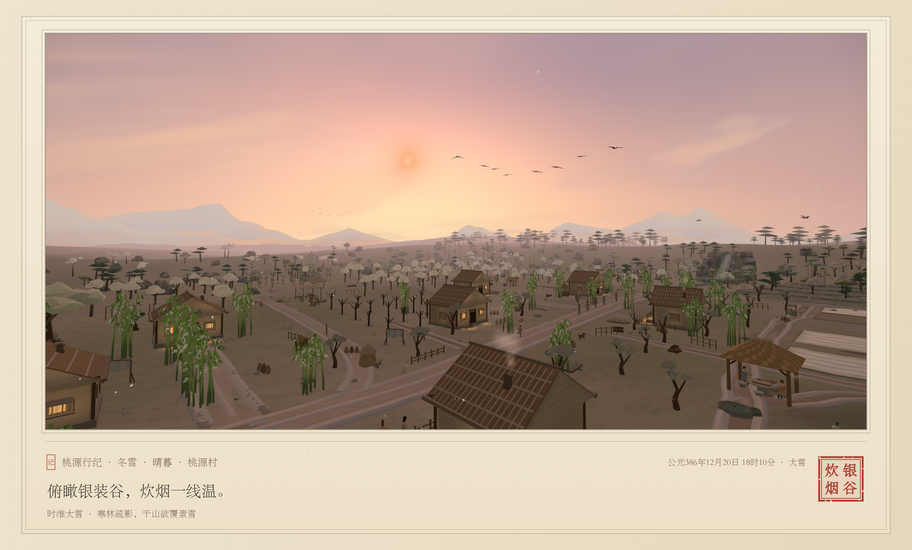
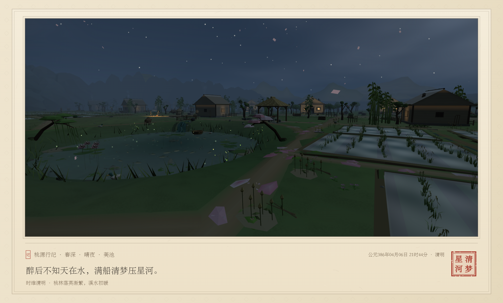

# 桃花源记 · Taohuayuan

> 忽逢桃花林，夹岸数百步，中无杂树，芳草鲜美，落英缤纷。

浏览器里的《桃花源记》水墨青绿 3D 活态世界：可漫步、可泛舟、可驻足，桌面键鼠与移动端触屏皆宜。纯静态构建、无后端、无运行时外部请求——构建后发链接即可直接点开玩。

**在线体验**：<https://fomalhaut1998.github.io/taohuayuan/>（GitHub Pages 自动部署：推送 main 即更新）



*本图与下文所有截图均为游戏内「画卷工坊」的题跋原图导出：带桃源行纪、节气时辰与印章，非后期加工。*

## 这是一个怎样的世界

以陶渊明《桃花源记》为母本的完整小世界，而非演示场景：武陵渔人缘溪行、忘路之远近，忽逢桃花林；山有小口，仿佛若有光；初极狭，才通人，复行数十步，豁然开朗——土地平旷，屋舍俨然，有良田美池桑竹之属。你可以用 15–25 分钟走完这段三幕叙事，也可以把主线完全搁下，在桃源里闲居漫游：看四时流转、听鸡犬相闻、泛舟、落座、御风、入画。

## 特色

### 1. 三幕叙事闭环与桃源简册
- 开屏四时绘本画幕启程，入山 → 豁然开朗 → 做客辞别三幕闭环，终章墨幕收束。
- 桃源简册（`Q`）：8 阶主线 + 9 支线托付；村民对话、待客宴饮、邻里剧场各有情境。
- 无时间焦虑设计：不推主线也不会错过世界，闲居漫游本身即完整体验。

### 2. 800×800 六大地理圈层与探索
- 武陵溪口与外郊、山口一线天、核心村落良田水工、谷地边野、外山秘境、深坳幽壑；另有 7 处山野秘境与彩蛋。
- 24 处 POI + 探索迷雾舆图（`M`）：走过的地方才揭晓；诗意寻津以诗句引路而非箭头堆砌。
- 近观识物（`G`）入图鉴：草木鸟兽虫鱼皆可驻足细看、收录成册。

### 3. 四时物候 × 十二时辰 × 四态天气
- 东晋太元十一年（公元 386 年）二十四节气公历时钟 × 十二时辰（晨 / 昼 / 暮 / 夜）连续流转。
- 春深落英、夏初新荷、秋熟金粟、冬寂薄雪四候；晴 / 雨 / 雾 / 冬雪四态天气。
- 冬候渐进积雪、池溪岸冰、雪韵舆图、雪地足迹、晴午檐冰滴水；切回春候逐字节无损还原。


*渔舟逐水爱山春，两岸桃花夹古津。*


*土地平旷，屋舍俨然，有良田美池桑竹之属。*


*暧暧远人村，依依墟里烟。狗吠深巷中，鸡鸣桑树颠。*


*俯瞰银装谷，炊烟一线温。*

### 4. 活态世界
- 村民作息与社区生活：炊烟、汲水、浣洗、聚谈、宴饮随昼夜与季节变化。
- 春畴牛耕、鸡犬鸭鹅、池鱼群鸟、林鹿鸣叫各有行为与昼夜节律；风雨来时避雨棚下自有去处。
- 水面波光倒影、笔意横云、草木风摆、落英风丝、夜萤、雨涟漪皆由轻量自定义着色器驱动。

### 5. 水墨低模美术
- 低多边形 + flatShading + 顶点色的青绿山水；母本色板：宣纸 `#F2EAD9`、墨 `#262626`、桃花 `#E8A0A8`、青绿 `#7BA05B`、深青 `#4A7C6F`。
- 禁写实、禁 PBR、禁照片贴图：3D 物件无贴图或 Canvas 程序化绘制，远山以青灰阶梯与雾色自然消隐。
- 大面积地物一律 InstancedMesh 批次 + 接触阴影 + LOD，水墨骨相与帧率兼得。

### 6. 大音希声的空间声景
- 原生 Web Audio 空间混音：洞门遮蔽、远距空气吸收、地表材质细化步伐声（木 / 石 / 土 / 草）。
- 本地短采样点缀五声、古琴、箫、远磬与鸡犬鱼鸟；稀疏留白，禁止喧闹堆音；不请求任何外部音频或在线 TTS。


*醉后不知天在水，满船清梦压星河。*

### 7. 画卷工坊与双层持久化
- 入画巡游（`L`）自带三维碰撞净空保护；画卷题跋自动识别地景、配诗、钤印，可导出原图（本 README 截图即出于此）。
- localStorage + IndexedDB 双层持久化：行旅进度与画卷原图各得其所。

### 8. 多种漫游姿态
- 第一人称行游 / 第三人称（`V`）、乘舟撑篙与收篙随波（`E` / `X`）、落座静赏与驻足静听（`E` / `C`）、轻跃低障（`Space`）、御风漫游（`P` / `B`）、一键入画巡游（`L`）。

### 9. 跨端适配与性能预算
- 移动端虚拟摇杆 + 划屏触控，屏上按钮对应全部情境动作；动态 DPR 与画质降档、竖屏 FOV 柔性补偿。
- 桌面 1080p ≥ 60fps、同屏 draw calls < 260；集显基准档 ≥ 55fps；移动端 ≥ 30–45fps。热路径零分配，长时浏览不掉帧。

### 10. 工程与回归
- 纯静态 Vite 构建、手动分包（three / world-data / shared-core / gameplay 等），首屏之外重面板真·动态 import。
- 89 项自动化回归检查（`npm test`）：几何、批次、碰撞、音频许可清单、性能热路径逐项门禁。

## 快速开始

需要 Node.js ≥ 18：

```bash
npm install
npm run dev       # 开发预览（Vite）
npm run build     # 产出纯静态 dist/
npm run preview   # 预览构建产物（端口 4173）
npm test          # 自动化回归检查集
```

运行时仅依赖 `three`；构建产物可托管于任意静态服务器（GitHub Pages、Netlify、Nginx 等）。

## 操作键位

| 键 | 作用 |
| --- | --- |
| `WASD` / 方向键 | 移动（`Shift` 疾行、`Space` 轻跃） |
| `V` | 第一 / 第三人称切换 |
| `E` / `X` | 情境交互（交谈 / 撑舟 / 落座）/ 收篙随波 |
| `M` / `Q` / `J` | 舆图 / 桃源简册 / 游记 |
| `G` / `C` | 近观识物入图鉴 / 驻足静听 |
| `O` / `L` | 画卷工坊 / 入画巡游（`L` 或 `Esc` 归步） |
| `P` / `B` | 御风漫游 |
| `K` / `?` | 时辰时钟 / 桃源小笺（帮助） |

移动端为虚拟摇杆 + 划屏触控，屏上按钮对应上述动作。

## 技术栈

Vite 6 + three（ES Modules）+ 原生 Web API（WebGL / Canvas 2D / Web Audio / localStorage / IndexedDB / Pointer Events）。无前端框架、无物理引擎、无后端服务。

## 目录结构

- `src/world/` 地理圈层与风物几何
- `src/systems/` 玩法、氛围与声景系统
- `src/player/` 控制、碰撞与触控
- `src/data/` 世界数据 JSON
- `public/audio/` 声景采样与许可文本
- `scripts/` 自动化回归检查
- `docs/` 开发志、计划与截图

## 素材许可与致谢

声景短采样来自 Freesound 等公开来源，以 CC0-1.0 为主，个别为 CC BY 4.0；逐条署名、来源链接与许可全文见 [public/audio/round3/NOTICE.md](public/audio/round3/NOTICE.md) 与 `public/audio/round3/licenses/`。**再分发请保留这些文件。**

## 开源许可

代码以 [MIT](LICENSE) 许可开源。音频素材按其各自许可（CC0 / CC BY 4.0）使用，不在 MIT 覆盖范围内。

`PROJECT_BRIEF.md` 与 `PROMPTS.md` 是本项目与 AI 协作的「世界宪法」与提示词模板，一并公开，供同类项目参考。
